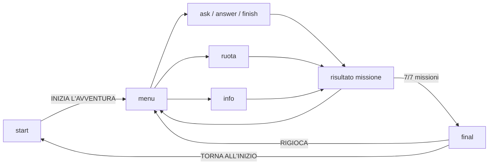
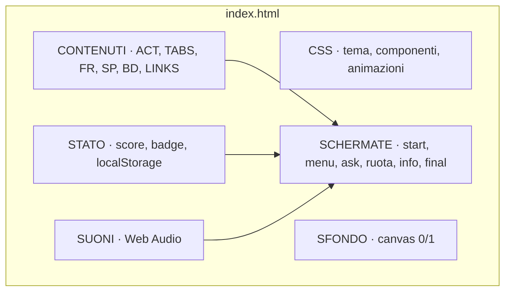

<div align="center">


# Open Day Informatica

**Un videogioco web per scoprire l'informatica, pensato per gli studenti delle scuole medie.**
Quiz, codice, enigmi da hacker, hardware, logica e una Ruota della Fortuna a squadre.


[Panoramica](#-panoramica) ·
[Anteprima](#-anteprima) ·
[Missioni](#-le-missioni) ·
[Avvio rapido](#-avvio-rapido) ·
[Personalizzazione](#-personalizzazione) ·
[Architettura](#-architettura) ·
[Roadmap](#-roadmap)

</div>

---

## 📖 Panoramica

**Open Day Informatica** è un'applicazione web interattiva realizzata per gli Open Day dell'indirizzo **Informatica** dell'**Istituto Omnicomprensivo "Rosselli-Rasetti"** di Castiglione del Lago (PG).

Non è un sito scolastico tradizionale: è un'esperienza di **gamification** che mostra ai ragazzi di 13-14 anni che l'informatica non è solo teoria, ma anche problem solving, creatività e divertimento. Può essere usata in autonomia dai ragazzi oppure guidati da studenti e docenti, su LIM, computer o tablet.

### Punti di forza

| | |
|---|---|
| 🎯 **Pensato per l'Open Day** | Missioni brevi, feedback immediato, nessuna configurazione richiesta |
| 🧩 **Zero dipendenze** | HTML, CSS e JavaScript puri: nessun framework, nessuna build, nessun server |
| 🔒 **Privacy by design** | Nessun login, nessun dato personale, nessun tracciamento, nessuna API esterna |
| 📱 **Ovunque** | Responsive: LIM, PC, tablet e smartphone |
| 💾 **Progressi salvati** | Salvataggio automatico nel browser (`localStorage`) |
| 🔊 **Audio sintetizzato** | Effetti sonori generati con la Web Audio API, attivabili con un pulsante |
| 🌗 **Tema chiaro/scuro** | Segue automaticamente le impostazioni del dispositivo |
| ♿ **Rispetto delle preferenze** | Animazioni ridotte con `prefers-reduced-motion` |

---

## 🖼️ Anteprima

<div align="center">

| Schermata iniziale | Menu delle missioni |
|:---:|:---:|
|  |  |
| **Quiz con feedback** | **Ruota della Fortuna** |
|  |  |
| **Schermata finale** | **Versione mobile** |
|  |  |

</div>

> Le anteprime sono state generate in un ambiente senza accesso ai Google Fonts: online i titoli usano il font *Orbitron* e il testo *Nunito*.

---

## 🕹️ Le missioni

| # | Missione | Obiettivo | Competenza |
|:-:|----------|-----------|------------|
| 1 | 🧠 **Quiz informatico** | 5 domande a risposta multipla | Cultura digitale |
| 2 | 💻 **Indovina il codice** | Leggere e correggere frammenti Python | Pensiero computazionale |
| 3 | 🕵️ **Hacker Challenge** | Cifrario di Cesare, binario, PIN, phishing | Logica e sicurezza |
| 4 | 🔧 **Hardware Detective** | Riconoscere CPU, GPU, SSD, RAM, scheda madre | Conoscenza dei componenti |
| 5 | 🧩 **Logic Game** | Sequenze numeriche e rompicapi | Ragionamento |
| 6 | 🎡 **Ruota della Fortuna** | Gioco a 2 squadre con frasi a tema informatico | Lavoro di squadra |
| 7 | 🚀 **Scopri l'indirizzo informatico** | Materie, laboratori e sbocchi | Orientamento |

Il box **🏫 Scopri la nostra scuola** (nel menu, nella pagina informativa e nella schermata finale) rimanda al sito ufficiale, alla presentazione PDF dell'indirizzo, ai video e alle pagine di Open Day e Mini Stage. I contenuti restano ospitati dal sito della scuola e si aprono in una nuova scheda.

### 🎡 Regole della Ruota della Fortuna

1. Le due squadre (nomi modificabili toccandoli) giocano a turno.
2. **Gira la ruota** → esce un valore → si sceglie una **consonante**: ogni occorrenza vale il punteggio dello spicchio.
3. Lettera presente → la squadra **mantiene il turno**; lettera assente → il turno passa.
4. **BANCAROTTA** azzera i punti della squadra, **PERDI TURNO** cede la mano.
5. Una **vocale** costa 1000 punti e si compra prima di girare.
6. La **frase finale** si può tentare nel proprio turno: +2000 punti se esatta, turno perso se sbagliata.
7. Le lettere si possono anche digitare con la tastiera del computer.

### 🏆 Punteggio e badge

- **+10 punti** per ogni risposta corretta.
- **+20 punti** di bonus per ogni missione completata (Ruota e pagina informativa comprese).
- Rigiocando una missione si conserva il **miglior risultato**.
- Punteggio massimo: **390 punti**. A missioni completate si sblocca il **finale**.

| Badge | Condizione |
|-------|------------|
| 👣 Primo passo nel coding | Completare *Indovina il codice* |
| 🔍 Detective dell'hardware | *Hardware Detective* con almeno 4/5 |
| 🧩 Mente logica | *Logic Game* con almeno 4/5 |
| 🛰️ Cyber Explorer | Completare la *Hacker Challenge* |
| 🎡 Campioni della Ruota | Vincere una manche alla Ruota |
| 🏆 Genio dell'informatica | Completare tutte le missioni |

---

## 🚀 Avvio rapido

### In locale

```bash
git clone https://github.com/<utente>/<repository>.git
cd <repository>
# apri index.html con il browser, oppure:
python3 -m http.server 8000   # poi visita http://localhost:8000
```

Non serve installare nulla.

### Pubblicazione con GitHub Pages

1. Carica `index.html`, la cartella `docs/` e questo `README.md` nella repository.
2. Vai in **Settings → Pages**.
3. In *Build and deployment* scegli **Deploy from a branch**, branch `main`, cartella `/ (root)`.
4. Dopo qualche minuto il sito sarà online all'indirizzo mostrato da GitHub.

### Consigli per l'Open Day

- Apri la pagina a schermo intero (**F11**) su PC o LIM.
- Tra un ragazzo e l'altro usa **RIGIOCA** nella schermata finale (azzera i progressi) oppure una finestra in incognito.
- Prova la pagina sui dispositivi che userai **prima** dell'evento e controlla che l'audio sia come desideri.

---

## 🛠️ Personalizzazione

Tutti i contenuti stanno nella parte alta del tag `<script>` di `index.html`, sotto il commento `CONTENUTI`.

| Cosa | Dove |
|------|------|
| Punti per risposta e bonus missione | costanti `PT` e `BONUS` |
| Domande di Quiz, Codice, Hacker, Hardware, Logic | array `ACT` |
| Testi della pagina sull'indirizzo | array `TABS` |
| Frasi della Ruota | array `FR` → `['Categoria', 'FRASE IN MAIUSCOLO']` (senza accenti) |
| Spicchi della ruota | array `SP` (numeri, `'BANCAROTTA'`, `'PERDI TURNO'`) |
| Costo della vocale | costante `COST` |
| Badge e condizioni | array `BD` |
| Link del box "Scopri la nostra scuola" | array `LINKS` |
| Colori e tema | variabili CSS in `:root` |
| Logo | attributo `src` di `#hl` (immagine incorporata in base64) |

### Aggiungere una domanda

```js
{
  q: 'Testo della domanda',
  o: ['Opzione A', 'Opzione B', 'Opzione C', 'Opzione D'],
  a: 1,                    // indice della risposta corretta (0 = prima opzione)
  x: 'Spiegazione mostrata dopo la risposta',
  k: 'print("ciao")',      // facoltativo: frammento di codice
  e: '🧠'                  // facoltativo: emoji grande sopra la domanda
}
```

Risposta **scritta** invece che a scelta multipla:

```js
{ q: 'Decifra: "TFSWFS"', in: 1, a: 'SERVER', x: 'Spiegazione…' }
```

### Aggiungere una missione

Inserisci in `ACT` un oggetto con `id`, `ic` (icona), `t` (titolo), `c` (colore), `d` (descrizione) e `qs` (domande): la card nel menu e il conteggio dei progressi si aggiornano da soli. Aggiorna poi `MAX` ed eventualmente i badge in `BD`.

---

## 🏗️ Architettura

Applicazione **single-page** senza build: ogni schermata è una funzione che sostituisce il contenuto di `<main>`, quindi la navigazione non ricarica mai la pagina.





### Struttura della repository

```
.
├── index.html          # applicazione completa (HTML + CSS + JS + logo)
├── README.md
└── docs/
    ├── logo.png
    └── screenshots/    # immagini usate nel README
```

### Scelte tecniche

- **Un solo file** per rendere il progetto portabile (si può copiare su chiavetta e aprire ovunque).
- **Nessuna libreria**: coriandoli, ruota (`<canvas>`), audio e sfondo animato sono scritti a mano.
- **Stato in memoria + `localStorage`** (chiave `rr_open`) con gestione degli errori se lo storage non è disponibile.
- **Contenuti separati dalla logica**, per permettere ai docenti di modificarli senza toccare il codice di gioco.

---

## 🌐 Compatibilità e requisiti

- Browser moderno con `canvas`, `localStorage` e Web Audio (Chrome, Edge, Firefox, Safari).
- Connessione Internet **consigliata**: i font *Orbitron* e *Nunito* arrivano da Google Fonts (senza rete si usano i font di sistema) e i link del box scuola portano al sito ufficiale.
- Nessun dato lascia il dispositivo: il gioco non invia nulla a server esterni.

---

## 🗺️ Roadmap

- [ ] Più domande per missione, con estrazione casuale a ogni partita
- [ ] Modalità "classifica" per sfide tra classi durante l'Open Day
- [ ] Nuovi mini-giochi (es. debug del codice, memory dei componenti)
- [ ] Modalità kiosk con riavvio automatico dopo inattività
- [ ] Revisione dei testi da parte dei docenti dell'indirizzo (in particolare la sezione "Dopo il diploma")
- [ ] Test su LIM e tablet in uso a scuola

## 🤝 Contribuire

Segnalazioni e proposte sono benvenute: apri una *issue* descrivendo il problema o l'idea, oppure una *pull request*. Per aggiungere domande o frasi basta modificare gli array nella sezione `CONTENUTI`.

## 📄 Crediti e licenza

- **Logo e contenuti istituzionali**: © Istituto Omnicomprensivo "Rosselli-Rasetti". Il logo non è coperto da licenza libera e va usato solo per le attività della scuola.
- **Font**: [Orbitron](https://fonts.google.com/specimen/Orbitron) e [Nunito](https://fonts.google.com/specimen/Nunito), licenza SIL Open Font License.
- **Codice**: da definire. Prima di pubblicare la repository aggiungi un file `LICENSE` con la licenza scelta dall'istituto.

<div align="center">

🔗 [Sito ufficiale della scuola](https://www.secondarieclago.edu.it/) · 💻 [Indirizzo Informatico](https://www.secondarieclago.edu.it/percorsi-studio?id=210) · 📅 [Open Day e Mini Stage](https://www.secondarieclago.edu.it/pagine/orientamento)

*Realizzato per l'Open Day dell'IIS Rosselli-Rasetti.*

</div>
