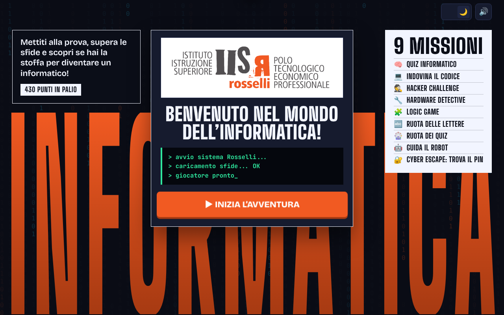
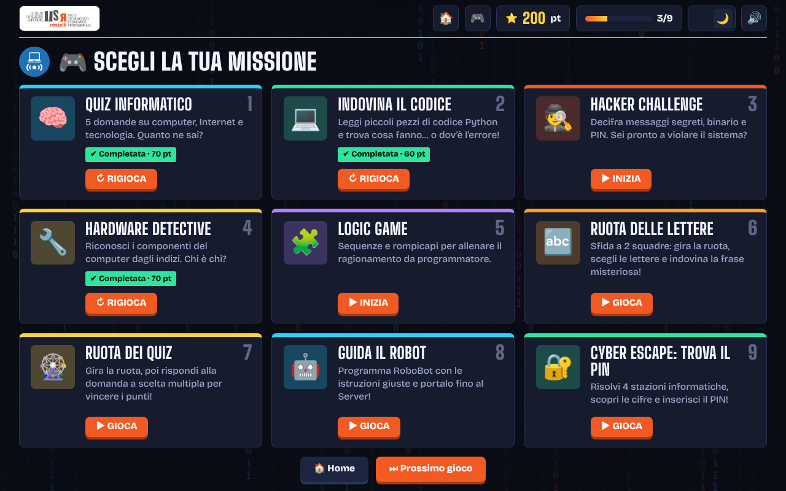
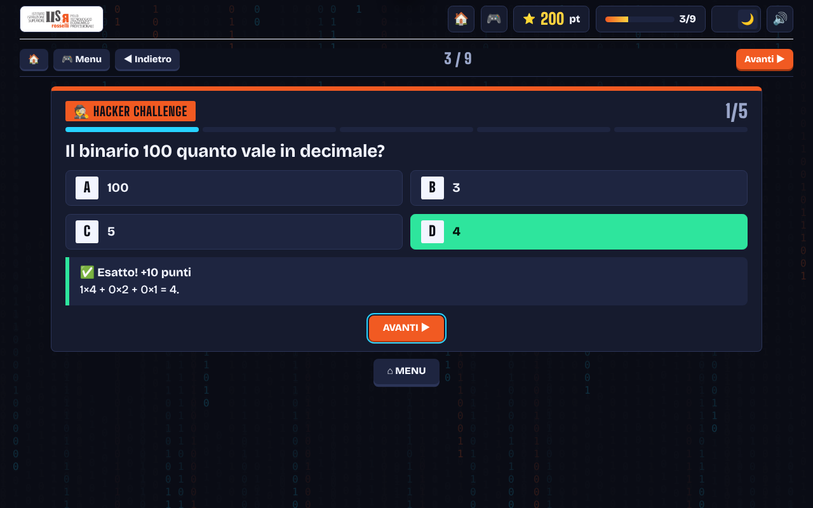
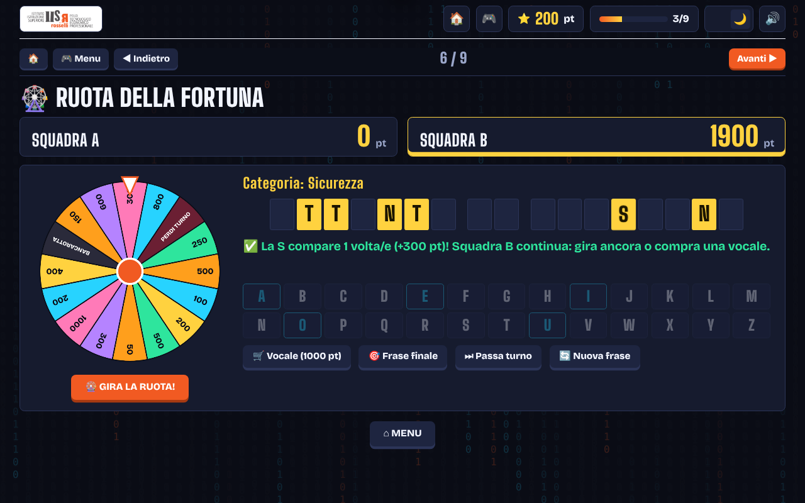
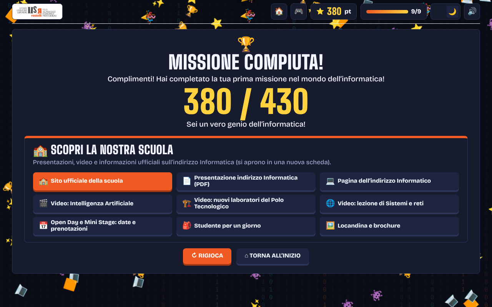
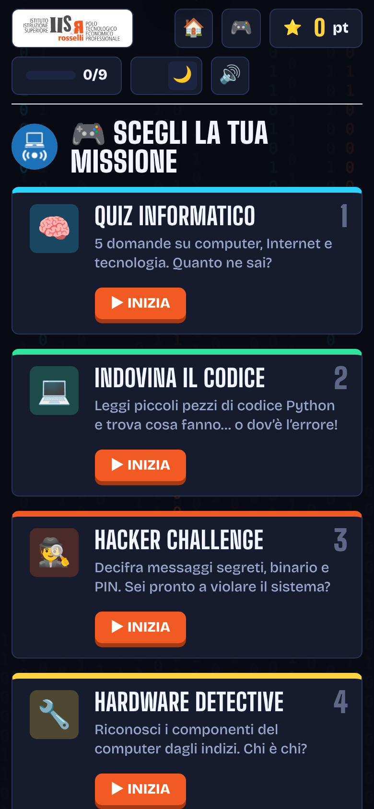
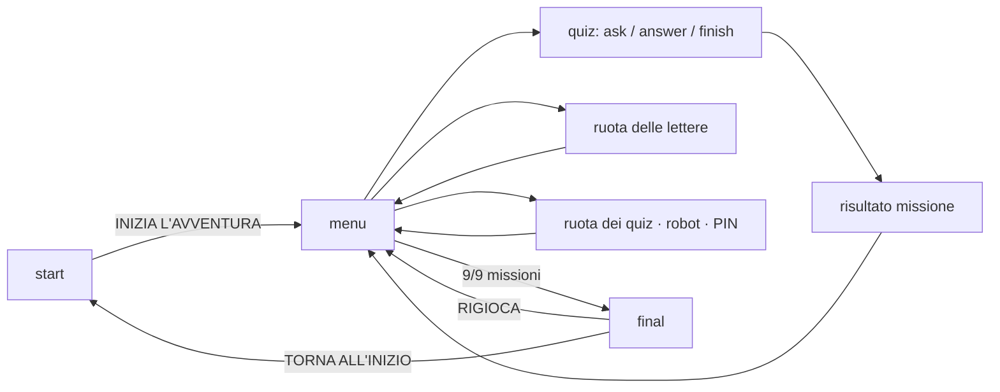

<div align="center">


# Open Day Informatica

**Un videogioco web per scoprire l'informatica, pensato per gli studenti delle scuole medie.**
Quiz, codice, enigmi da hacker, hardware, logica, due ruote a squadre, un robot da programmare e un PIN da scoprire.


[Panoramica](#-panoramica) ·
[Anteprima](#-anteprima) ·
[Missioni](#-le-missioni) ·
[Avvio rapido](#-avvio-rapido) ·
[Personalizzazione](#-personalizzazione) ·
[Architettura](#-architettura) ·
[Roadmap](#-roadmap)

</div>

---

## 📖 Panoramica

**Open Day Informatica** è un'applicazione web interattiva realizzata per l'orientamento dell'indirizzo **Informatica** dell'**Istituto Omnicomprensivo "Rosselli-Rasetti"** di Castiglione del Lago (PG).

Non è un sito scolastico tradizionale: è un'esperienza di **gamification** che mostra ai ragazzi di 13-14 anni che l'informatica non è solo teoria, ma anche problem solving, creatività e divertimento. È pensata per essere condotta da **una persona sola con un computer collegato a un proiettore**, ma funziona anche su LIM, tablet e smartphone.

### Punti di forza

| | |
|---|---|
| 🎯 **Pensato per l'aula** | Testi grandi e leggibili dal fondo, ogni gioco sta in una schermata a 1920×1080 e 1366×768 |
| 🧩 **Nessuna build** | HTML, CSS e JavaScript puri: tre file, nessun framework, nessun server |
| 🔒 **Privacy by design** | Nessun login, nessun dato personale, nessun tracciamento |
| 📱 **Ovunque** | Responsive: proiettore, LIM, PC, tablet e smartphone |
| 💾 **Progressi salvati** | Salvataggio automatico nel browser (`localStorage`) |
| 🔊 **Audio sintetizzato** | Effetti sonori generati con la Web Audio API, attivabili con un pulsante |
| 🌗 **Tema scuro/chiaro** | Un interruttore in alto a destra; il chiaro rende meglio con proiettori deboli in aule luminose |
| ♿ **Rispetto delle preferenze** | Animazioni ridotte con `prefers-reduced-motion` |

---

## 🖼️ Anteprima

<div align="center">

| Schermata iniziale | Menu delle missioni |
|:---:|:---:|
|  |  |
| **Quiz con feedback** | **Ruota delle lettere** |
|  |  |
| **Schermata finale** | **Versione mobile** |
|  |  |

</div>

---

## 🕹️ Le missioni

| # | Missione | Obiettivo | Competenza |
|:-:|----------|-----------|------------|
| 1 | 🧠 **Quiz informatico** | 5 domande a risposta multipla | Cultura digitale |
| 2 | 💻 **Indovina il codice** | Leggere e correggere frammenti Python | Pensiero computazionale |
| 3 | 🕵️ **Hacker Challenge** | Cifrario di Cesare, binario, PIN, phishing | Logica e sicurezza |
| 4 | 🔧 **Hardware Detective** | Riconoscere componenti e periferiche | Conoscenza dei componenti |
| 5 | 🧩 **Logic Game** | Sequenze numeriche e rompicapi | Ragionamento |
| 6 | 🔤 **Ruota delle lettere** | Gioco a 2 squadre con frasi a tema informatico | Lavoro di squadra |
| 7 | 🎡 **Ruota dei quiz** | Gira la ruota e rispondi per vincere i punti dello spicchio | Cultura digitale a squadre |
| 8 | 🤖 **Guida il robot** | Programmare RoboBot con blocchi di istruzioni, 5 livelli | Algoritmi e sequenze |
| 9 | 🔐 **Cyber Escape: trova il PIN** | 4 stazioni da sbloccare, ognuna rivela una cifra | Sicurezza e logica |

Nelle prime cinque missioni ogni partita pesca **5 domande a caso** da un gruppo più ampio e mescola le risposte. Le risposte sono contrassegnate **A, B, C, D**, così la classe può rispondere a voce.

Il box **🏫 Scopri la nostra scuola** (nel menu e nella schermata finale) rimanda al sito ufficiale, alla presentazione PDF dell'indirizzo, ai video e alle pagine di Open Day e Mini Stage. I contenuti restano ospitati dal sito della scuola e si aprono in una nuova scheda.

### 🔤 Regole della Ruota delle lettere

1. Le due squadre (nomi modificabili toccandoli) giocano a turno.
2. **Gira la ruota** → esce un valore → si sceglie una **consonante**: ogni occorrenza vale il punteggio dello spicchio.
3. Lettera presente → la squadra **mantiene il turno**; lettera assente → il turno passa.
4. **BANCAROTTA** azzera i punti della squadra, **PERDI TURNO** cede la mano.
5. Una **vocale** costa 1000 punti e si compra prima di girare.
6. La **frase finale** si può tentare nel proprio turno: +2000 punti se esatta, turno perso se sbagliata.
7. Le lettere si possono anche digitare con la tastiera del computer.

### 🏆 Punteggio

- **+10 punti** per ogni risposta corretta nelle missioni 1-5.
- **+20 punti** di bonus per ogni missione completata (missioni 6-9 comprese).
- Rigiocando una missione si conserva il **miglior risultato**.
- Punteggio massimo: **430 punti**. A missioni completate si sblocca il **finale**.

### ⌨️ Tasti utili per chi conduce

| Tasto | Cosa fa |
|-------|---------|
| `Esc` | Torna al menu (o chiude il messaggio aperto) |
| `←` `→` | Gioco precedente / successivo |
| `A`–`Z` | Sceglie la lettera nella Ruota delle lettere |
| `F11` | Schermo intero del browser |

---

## 🚀 Avvio rapido

### In locale

```bash
git clone https://github.com/leonardoBernetti/Orientamento-Scuole-Medie.git
cd Orientamento-Scuole-Medie
# apri index.html con il browser, oppure:
python3 -m http.server 8000   # poi visita http://localhost:8000
```

Non serve installare nulla.

### Pubblicazione con GitHub Pages

1. Carica nella repository `index.html`, `style.css`, `app.js`, `favicon.png` e le cartelle `assets/` e `docs/`.
2. Vai in **Settings → Pages**.
3. In *Build and deployment* scegli **Deploy from a branch**, branch `main`, cartella `/ (root)`.
4. Dopo qualche minuto il sito sarà online all'indirizzo mostrato da GitHub.

### Consigli per la giornata

- Apri la pagina a schermo intero (**F11**).
- Scegli il tema in base all'aula: **scuro** se la stanza è buia, **chiaro** se c'è molta luce o il proiettore è debole.
- Tra una classe e l'altra usa **RIGIOCA** nella schermata finale (azzera i progressi) oppure una finestra in incognito.
- Prova la pagina sul computer e sul proiettore che userai **prima** dell'evento e controlla che l'audio sia come desideri.

---

## 🛠️ Personalizzazione

I contenuti stanno in `app.js`. Domande, frasi e link principali sono in cima, sotto il commento `CONTENUTI`.

| Cosa | Dove |
|------|------|
| Punti per risposta e bonus missione | costanti `PT` e `BONUS` |
| Domande di Quiz, Codice, Hacker, Hardware, Logic | array `ACT` e, per le domande aggiuntive, oggetto `MORE` |
| Frasi della Ruota delle lettere | array `FR` → `['Categoria', 'FRASE IN MAIUSCOLO']` (senza accenti) |
| Spicchi della Ruota delle lettere | array `SP` (numeri, `'BANCAROTTA'`, `'PERDI TURNO'`) |
| Costo della vocale | costante `COST` |
| Spicchi e domande della Ruota dei quiz | array `wheelSectors` e `techQuestions` |
| Livelli del robot | array `mazeLevels` |
| Domande delle stazioni del PIN | oggetto `PS` |
| Link del box "Scopri la nostra scuola" | array `LINKS` |
| Colori e tema | variabili CSS in `:root`, all'inizio di `style.css` |
| Logo | file `assets/logo.png` |

### Aggiungere una domanda

```js
{
  q: 'Testo della domanda',
  o: ['Opzione A', 'Opzione B', 'Opzione C', 'Opzione D'],
  a: 1,                    // indice della risposta corretta (0 = prima opzione)
  x: 'Spiegazione mostrata dopo la risposta',
  k: 'print("ciao")',      // facoltativo: frammento di codice
  e: '🧠'                  // facoltativo: emoji grande sopra la domanda
}
```

Risposta **scritta** invece che a scelta multipla:

```js
{ q: 'Decifra: "TFSWFS"', in: 1, a: 'SERVER', x: 'Spiegazione…' }
```

### Aggiungere una missione a domande

Inserisci in `ACT` un oggetto con `id`, `ic` (icona), `t` (titolo), `c` (colore), `d` (descrizione) e `qs` (domande): la card nel menu, il conteggio dei progressi e il punteggio massimo si aggiornano da soli.

---

## 🏗️ Architettura

Applicazione **single-page** senza build: ogni schermata è una funzione che sostituisce il contenuto di `<main>`, quindi la navigazione non ricarica mai la pagina.



### Struttura della repository

```
.
├── index.html          # struttura della pagina e collegamenti a font e librerie
├── style.css           # tutta la grafica: colori, tipografia, componenti, schermate
├── app.js              # contenuti e logica dei giochi
├── favicon.png
├── assets/             # logo della scuola e dell'indirizzo, icona
├── README.md
└── docs/
    ├── logo.png
    └── screenshots/    # immagini usate nel README
```

### Scelte tecniche

- **Tre file separati** (struttura, grafica, logica) per poter cambiare l'aspetto senza toccare i giochi e viceversa.
- **Un solo sistema grafico**: tutte le schermate usano le stesse variabili CSS, quindi il tema scuro/chiaro vale ovunque.
- **Testo fluido**: la dimensione di base cresce con lo schermo (circa 20px su un proiettore Full HD), e tutte le misure sono in `rem`.
- **Messaggi in pagina** al posto delle finestre `alert()` del browser.
- **Stato in memoria + `localStorage`** (chiavi `rr_open` per i progressi e `rr_theme` per il tema) con gestione degli errori se lo storage non è disponibile.
- **Contenuti separati dalla logica**, per permettere ai docenti di modificarli senza toccare il codice di gioco.

### Librerie esterne

Caricate da CDN, quindi serve la connessione a Internet:

| Libreria | A cosa serve |
|----------|--------------|
| Google Fonts: *Big Shoulders Display*, *Bricolage Grotesque*, *JetBrains Mono* | Titoli, testi, codice |
| Font Awesome 6.4 | Icone dei pulsanti in Ruota dei quiz, Robot e PIN |
| canvas-confetti 1.6 | Coriandoli (se manca, entrano in gioco quelli a emoji già inclusi) |

---

## 🌐 Compatibilità e requisiti

- Browser moderno e aggiornato (Chrome, Edge, Firefox, Safari) con `canvas`, `localStorage` e Web Audio.
- Connessione a Internet per font, icone e link della scuola.
- Nessun dato lascia il dispositivo: il gioco non invia nulla a server esterni.

---

## 🗺️ Roadmap

- [x] Più domande per missione, con estrazione casuale a ogni partita
- [ ] Modalità "classifica" per sfide tra classi durante l'Open Day
- [ ] Nuovi mini-giochi (es. debug del codice, memory dei componenti)
- [ ] Esecuzione davvero passo-passo nel gioco del robot (oggi "Passo-Passo" esegue tutta la sequenza)
- [ ] Modalità kiosk con riavvio automatico dopo inattività
- [ ] Revisione dei testi da parte dei docenti dell'indirizzo
- [ ] Test su proiettore e LIM in uso a scuola

## 🤝 Contribuire

Segnalazioni e proposte sono benvenute: apri una *issue* descrivendo il problema o l'idea, oppure una *pull request*. Per aggiungere domande o frasi basta modificare gli array nella sezione `CONTENUTI` di `app.js`.

## 📄 Crediti e licenza

- **Logo e contenuti istituzionali**: © Istituto Omnicomprensivo "Rosselli-Rasetti". Il logo non è coperto da licenza libera e va usato solo per le attività della scuola.
- **Font**: [Big Shoulders Display](https://fonts.google.com/specimen/Big+Shoulders+Display), [Bricolage Grotesque](https://fonts.google.com/specimen/Bricolage+Grotesque) e [JetBrains Mono](https://fonts.google.com/specimen/JetBrains+Mono), licenza SIL Open Font License.
- **Icone**: [Font Awesome Free](https://fontawesome.com/).
- **Coriandoli**: [canvas-confetti](https://github.com/catdad/canvas-confetti).
- **Codice**: da definire. Prima di pubblicare la repository aggiungi un file `LICENSE` con la licenza scelta dall'istituto.

<div align="center">

🔗 [Sito ufficiale della scuola](https://www.secondarieclago.edu.it/) · 💻 [Indirizzo Informatico](https://www.secondarieclago.edu.it/percorsi-studio?id=210) · 📅 [Open Day e Mini Stage](https://www.secondarieclago.edu.it/pagine/orientamento)

*Realizzato per l'orientamento dell'IIS Rosselli-Rasetti.*

</div>
